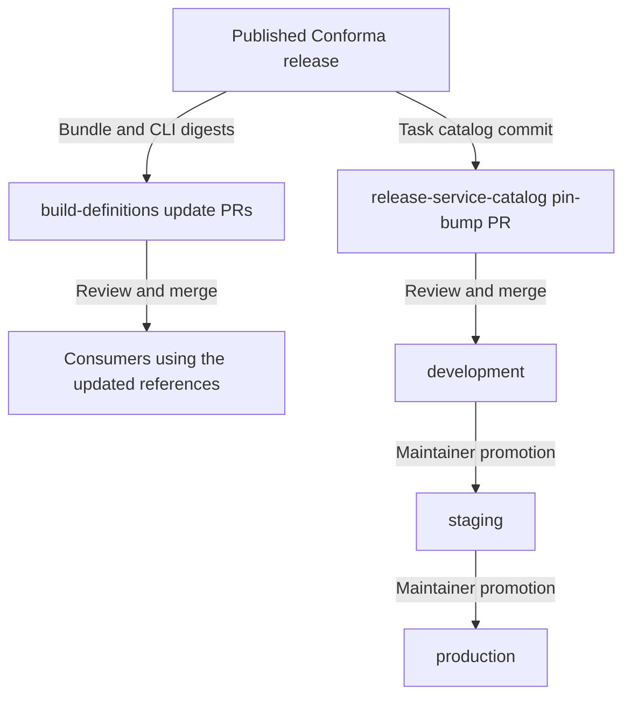

# Phase 2: Roll out a Conforma release in Konflux

Start after [Conforma publication](RELEASE_WORKFLOW.md). The Conforma team supplies
the release identities, prepares or follows consumer-update PRs, and tracks
adoption. **Konflux repository maintainers own their CI, merge requirements,
environment promotions and exceptions.** Coordinate with them rather than treating
these workflows as another Conforma-owned release job.

There are independent consumer paths. Completing one does not complete the other:



This is the normal path. The release catalog also has a selective hotfix path,
described below.

## 1. Handoff

Bring the [publication record](RELEASE_WORKFLOW.md#3-verify-publication-and-record-the-handoff):
release PR/changelog, successful workflow run, actual CLI and rebuilt task-bundle
digests, policy digests, and the full `conforma/tekton-catalog` release commit SHA.
Use these identities when reviewing downstream changes.

Keep the two catalogs distinct:

- `conforma/tekton-catalog` contains Conforma tasks and StepActions. Phase 1 updates
  its **`konflux`** branch. Its `main` and `release-v*` branches have a separate
  [CLI sync workflow][catalog-sync]; they are not the Konflux release channel.
- `konflux-ci/release-service-catalog` contains managed release pipelines. Those
  pipelines pin a Conforma task-catalog **commit SHA**. Moving the Conforma
  `konflux` branch does not update that pin.

For managed releases, the `ReleasePlanAdmission` selects the catalog URL, revision
and pipeline path through `spec.pipeline.pipelineRef` (see the
[example resolver configuration][rsc-rpa]). That pipeline pins a Conforma task SHA;
the task selects CLI images and policy pinning defaults. These are separate
version selections, not one global "Conforma version in Konflux".

## 2. Update the consumer pins

### Build-definitions and integration consumers

Follow the [Renovate updates in build-definitions][build-renovate] for the published
bundle and CLI digests. Ask its maintainers to review and merge the relevant PRs
after their checks pass. Inspect changed paths, not just PR titles:

| Changed reference | What it affects |
| --- | --- |
| [`pipelines/enterprise-contract.yaml`][build-pipeline] task-bundle digests | Integration scenarios resolving this compatibility pipeline at the updated revision. |
| [`.tekton/tasks/ec-checks.yaml`][build-checks] CLI images | Conforma checks of build-definitions' own task/StepAction definitions. This is repository CI, not tenant verification rollout. |
| [`e2e-tests/tests/build/build_templates.go`][build-e2e] bundle reference | The repository's e2e harness. Updating it alone does not update tenant pipelines. |

The Renovate `ec` group covers the compatibility pipeline and repository CI;
the Go e2e bundle reference has a separate regex manager. One release can therefore
produce multiple update PRs.

The build-definitions pipeline is marked **deprecated**, with its source of truth
now in `conforma/cli` and a published copy in `conforma/tekton-catalog`. Inspect the
affected tenant's `IntegrationTestScenario` resolver to establish which repository,
path and revision it actually uses. A merge to build-definitions `main` does not
rewrite scenarios pinned to an older commit or using another pipeline.

### Managed release pipelines

Prepare a pin-bump PR against **`development`** in `release-service-catalog`. From
that repository's checkout, use the supplied helper:

```bash
./scripts/bump-conforma-revision.sh
git diff -- pipelines/
```

The [helper][bump-script] resolves the current head of
`conforma/tekton-catalog`'s `konflux` branch and updates matching Git-resolver
references under `pipelines/`. It requires GNU `sed` (`gsed` on systems whose
`sed` is not GNU).

Confirm its printed SHA is the release SHA from the handoff. It always follows the
current branch head, not a release-directory argument. If the channel has advanced,
do not silently substitute the newer release. Review every affected pipeline,
including ones on older pins; the helper's file count is not a substitute for
reviewing the diff.

Include the release changelog, publication run and old/new task-catalog revisions
in the PR. Follow the repository's [contribution requirements][rsc-contributing]
and ask the Release Service maintainers for review. Its
[managed e2e pipeline][rsc-pipeline] shows the Git-resolver fields being changed.

Merging this PR means **the bump is in `development`**. It does not update the
`staging` or `production` branch.

## 3. Promote the release catalog

### Normal promotion: whole branches, no promotion PR

Ask the Release Service maintainers to include the bump in their next promotion.
They run [Promote branch][promote-action] with one of these `promotion-type` values:

| Promotion | Result |
| --- | --- |
| `development-to-staging` | Replaces the `staging` branch with the current development content. This includes other pending catalog changes, not just Conforma. |
| `staging-to-production` | Replaces `production` with the staging content. Releases configured to resolve this branch can then use its updated pipelines. |

The [workflow][promote-workflow] is manually dispatched. Its
[script][promote-script] force-pushes the source branch to the target branch;
**it does not open a PR**. Track workflow runs and branch contents, not the absence
or presence of a follow-up PR.

The current guards explain why a merged bump may still be waiting:

| Guard | Current implementation |
| --- | --- |
| Before development → staging | Requires staging and production **file contents** to match, unless `force-to-staging` is selected. Commit-count differences alone do not establish this condition. |
| Before staging → production | Rejects staging history containing commits newer than its six-day cutoff, unless `override` is selected. This checks Git commit timestamps, **not when the revision arrived in staging**. |
| Before either promotion | Checks that target-only hotfix changes are present in the source. `override-hotfix-check` bypasses that protection and is a maintainer decision. |

Do not calculate a production date from the merge date or assume a guaranteed
six-day staging residence. Agree on staging validation and promotion timing with
the maintainers. A green PR check named **Konflux Staging** is also not a
promotion: the [staging e2e pipeline][rsc-tests] can test the PR's own revision on
staging infrastructure while the `staging` branch remains unchanged.

For a Conforma pin bump, the workflow's optional controller/infra-promotion
switches are separate work, not an inherent requirement. Leave them to the
maintainers. Also, `dry-run` suppresses the catalog push, not all optional workflow
side effects; controller promotion and email options must remain off for a
catalog-only preview.

### Expedited promotion: hotfix PRs

For an urgent release, ask the maintainers whether to use
[Hot Fix PR][hotfix-action] instead of waiting for a whole-branch promotion.

- An exact `/hotfix` comment on a **merged development PR** requests cherry-picks
  into both `staging` and `production`.
- Manual dispatch can select `both`, `staging` or `production` using
  `target-branches` and `pr-number`.
- The [workflow][hotfix-workflow] and [helper][hotfix-script] create real
  `hotfix/pr-<number>-to-<branch>-...` PRs. They do not merge them. Each still needs
  the target branch's checks, reviews and maintainer approval.
- Conflicts require maintainer intervention. Check which PRs were actually created;
  one target can succeed before the other fails.

This path carries the selected change rather than the entire development batch.
Creating hotfix PRs is not deployment, and it is not a reason to skip agreed
validation.

## 4. Confirm adoption

Track the two consumer paths separately. For the release catalog, record the
actual state rather than saying only "the PR merged":

| Evidence | What can be claimed |
| --- | --- |
| Bump merged to `development` | Ready for environment promotion. |
| Intended pins present on `staging` | Staging catalog updated; validate new runs using that branch. |
| Intended pins present on `production` | Production catalog updated; validate new runs using that branch. |
| Resolved versions and results from an affected workload | Adoption verified for that consumer/environment. |

Normal promotion history is available with this read-only command:

```bash
gh run list --repo konflux-ci/release-service-catalog \
  --workflow promote_branch.yaml
```

For each target environment:

1. Confirm the relevant pipeline files contain the intended Conforma SHA, or the
   intended bundle digest for bundle-based consumers. Check all affected pipelines,
   not a single representative file. Retain the promotion run or hotfix PR links.
2. With the maintainer or tenant owner, inspect a **new** release/integration
   PipelineRun and its Conforma TaskRun. Confirm the resolved pipeline/task
   revision, CLI image digest, effective policy reference/digest and expected
   validation result. Previously resolved runs do not prove adoption of a later
   promotion.
3. Record that evidence alongside the release and consumer PRs. If a tenant pins a
   different revision or overrides the policy, track it separately rather than
   claiming platform-wide rollout.

### Policy references need their own check

The published task's `POLICY_BUNDLE_DIGEST` is intended to keep its policy aligned
with the CLI, but its effect depends on the task version and configured reference.
Inspect the [runtime pin helper][policy-pin] and the resolved policy/logs. In the
current helper, the canonical `oci::quay.io/conforma/release-policy:konflux` URL is
rewritten; the legacy `oci::quay.io/enterprise-contract/ec-release-policy:konflux`
URL is not. Existing digest pins are left in place; an empty
`POLICY_BUNDLE_DIGEST` skips the override.

A floating policy reference can therefore pick up a tag change independently of
the task rollout. Do not infer policy adoption or isolation from the task SHA alone.

## 5. Rollback

Coordinate rollback with the owners of each affected consumer. Restoring Conforma
registry tags or catalog branch content in
[Phase 1](RELEASE_WORKFLOW.md#4-recover-from-a-partial-publication-or-roll-back)
does not restore existing digest- or SHA-pinned consumers.

- Restore the known-good Conforma task SHA in affected release-catalog pipelines
  and get the correction into the affected environment branches through the
  maintainer-approved route. Keep development consistent so a later normal
  promotion does not reintroduce the bad pin.
- Restore affected bundle/CLI digests in build-definitions and any independently
  pinned integration scenarios. Repository CI/e2e pins and tenant pins are separate.
- Check floating policy consumers separately if policy tags were moved.
- Verify the recovered versions and behavior in new runs before closing recovery.

Do not use `bump-conforma-revision.sh` blindly for rollback: it selects the current
Conforma `konflux` head, not an explicit known-good revision.

[catalog-sync]: https://github.com/conforma/tekton-catalog/blob/main/.github/workflows/sync-ec-cli-tasks.yaml
[build-renovate]: https://github.com/konflux-ci/build-definitions/blob/main/renovate.json
[build-pipeline]: https://github.com/konflux-ci/build-definitions/blob/main/pipelines/enterprise-contract.yaml
[build-checks]: https://github.com/konflux-ci/build-definitions/blob/main/.tekton/tasks/ec-checks.yaml
[build-e2e]: https://github.com/konflux-ci/build-definitions/blob/main/e2e-tests/tests/build/build_templates.go
[bump-script]: https://github.com/konflux-ci/release-service-catalog/blob/development/scripts/bump-conforma-revision.sh
[rsc-contributing]: https://github.com/konflux-ci/release-service-catalog/blob/development/CONTRIBUTING.md
[rsc-pipeline]: https://github.com/konflux-ci/release-service-catalog/blob/development/pipelines/managed/e2e/e2e.yaml
[rsc-rpa]: https://github.com/konflux-ci/release-service-catalog/blob/development/integration-tests/e2e/resources/managed/rpa.yaml
[promote-action]: https://github.com/konflux-ci/release-service-catalog/actions/workflows/promote_branch.yaml
[promote-workflow]: https://github.com/konflux-ci/release-service-catalog/blob/development/.github/workflows/promote_branch.yaml
[promote-script]: https://github.com/konflux-ci/release-service-catalog/blob/development/.github/scripts/promote_branch.sh
[rsc-tests]: https://github.com/konflux-ci/release-service-catalog/blob/development/integration-tests/pipelines/e2e-tests-staging-pipeline.yaml
[hotfix-action]: https://github.com/konflux-ci/release-service-catalog/actions/workflows/hot_fix_pr.yaml
[hotfix-workflow]: https://github.com/konflux-ci/release-service-catalog/blob/development/.github/workflows/hot_fix_pr.yaml
[hotfix-script]: https://github.com/konflux-ci/release-service-catalog/blob/development/.github/scripts/hot_fix_pr.sh
[policy-pin]: https://github.com/conforma/cli/blob/main/hack/pin-konflux-policy-bundle.sh
