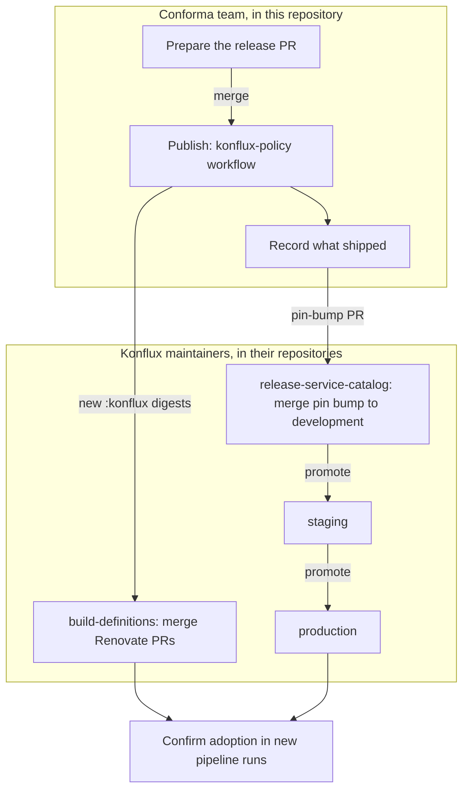

# Releasing Conforma to Konflux

## The big picture

A Conforma release publishes policy bundles, the CLI image and Tekton task definitions to
the **`konflux` release channel**: `:konflux` tags on Quay plus the `konflux` branch of
`conforma/tekton-catalog`. You propose it with a PR that adds a `releases/<timestamp>/`
directory to this repository (`conforma/infra-deployments-ci`); merging runs the
`konflux-policy` workflow, which tests the release and publishes it. **Publishing is not
deploying**: Konflux pins Conforma's tasks by digest or commit SHA, so users get the
release only after Konflux maintainers merge pin bumps in `build-definitions` and
`release-service-catalog`, then promote the latter from `development` to `staging` and
`production`. The pinning is deliberate: every environment runs a known CLI and policy
pair until a reviewed update changes it.

## Lifecycle flow



### What ships and who picks it up

| Artifact | Published to | Picked up by |
| --- | --- | --- |
| Policy bundles (release, task, build-task) | `quay.io/conforma/*-policy:konflux` and `quay.io/enterprise-contract/ec-*-policy:konflux` mirrors | Configs referencing the tag, on their next run. Conforma tasks pin the release policy ([details](#unexpected-policy-version)). |
| CLI image | `quay.io/conforma/cli:konflux` | Task definitions, by digest |
| Task bundle | `quay.io/conforma/tekton-task:konflux` | `build-definitions`, by digest (Renovate PRs) |
| Task and StepAction YAML | `conforma/tekton-catalog`, `konflux` branch | `release-service-catalog`, by commit SHA (manual pin bump) |

**Two catalogs, easy to confuse.** `conforma/tekton-catalog` holds Conforma's tasks, and
only its `konflux` branch is the release channel. `konflux-ci/release-service-catalog`
holds Konflux's release pipelines, which pin a `conforma/tekton-catalog` commit: moving
the `konflux` branch changes nothing there until someone bumps the pin.

## Roles and ownership

| Who | Does | How |
| --- | --- | --- |
| **Release owner** (Conforma team) | Prepares and merges the release PR, records what shipped, opens the `release-service-catalog` pin bump, tracks adoption | Manual |
| **`konflux-policy` workflow** | Tests, moves the `:konflux` tags, rebuilds the bundle, pushes the catalog branch | Automatic on merge |
| **`build-definitions`** (Renovate, maintainers) | Renovate opens digest PRs; maintainers merge them | Automatic PRs, manual merge |
| **Release Service maintainers** | Review the pin bump, promote, decide on hotfixes and guard overrides | Manual, by workflow dispatch |
| **Tenant owners** | Own pins and policy overrides in their own scenarios and release plans | Manual |

In Konflux repositories you supply the release identities and ask; the maintainers decide
merges, promotions and exceptions.

## Step-by-step execution

Phases 1 to 3 run here. Phases 4 to 6 run in Konflux repositories and wait on their
maintainers.

### Phase 1: Prepare the release

**Prerequisites:** Bash, Git, `gh`, Go, `crane`, `jq`, Mike Farah's `yq`, and a running
Docker or Podman engine (`export CONTAINER_ENGINE=podman` for Podman). The Golden RPM test
image needs Quay credentials: set `REGISTRY_AUTH_FILE` to a Docker-compatible auth file
([details](../README.md#prerequisites)).

1. **Generate the proposal** from the repository root. It writes
   `releases/<UTC-timestamp>/` locally and publishes nothing.

   ```bash
   ./hack/generate-changelog.sh
   ```

   | File | For | Contents |
   | --- | --- | --- |
   | `changelog.md` | Reviewers | Candidate digests, source PRs, rule changes, behavior comparison |
   | `images.json` | The workflow | Candidate digests and policy mirror destinations |

2. **Check that it succeeded**: a zero exit status and a complete behavior comparison
   section. The files are written before the comparison runs, so their existence proves
   nothing.

3. **Review the proposal.**
   - **Digests agree** between `changelog.md` and `images.json`. `:latest` can move
     mid-run; regenerate if they differ.
   - **Rule changes look right**: additions, removals, `effective_on` dates, collections,
     mirrors.
   - **Behavior differences are understood.** The comparison runs the current and
     candidate CLI/policy pairs against Golden container and Golden RPM.
   - **You know what ships.** Only the policy digests come from `images.json`. The CLI
     and task bundle come from `quay.io/conforma/tekton-task:latest` at run time, and the
     workflow can't pick a different CLI.

4. **Open a PR to `main`** with both files in **one new** release directory. The
   [lead-time check](../.github/workflows/check-release-lead-time.yaml) requires every
   newly added policy rule to have an RFC3339 `effective_on` at least **56 days** after
   the check runs. To run it locally:

   ```bash
   bash ./hack/check-release-lead-time.sh releases/<release-directory>/images.json
   ```

### Phase 2: Publish

1. **Merge the release PR** once checks and required reviews pass. **Merge one release
   directory at a time**: a push publishes only the first new `images.json` it adds.

2. **Watch the [`konflux-policy`](../.github/workflows/konflux-policy.yaml) run** on its
   [Actions page][konflux-policy-runs]. The last two jobs run in parallel:

   | Job | What it does |
   | --- | --- |
   | `acceptance-tests` | Resolves `tekton-task:latest` and its CLI to digests, then runs the Golden container and RPM scenarios on a temporary Kind cluster |
   | `tag` | Moves `:konflux` for the `images.json` policy digests (plus `quay.io/enterprise-contract` mirrors) and for the captured CLI |
   | `update-task-definitions` | Extracts tasks from the captured bundle, sets `POLICY_BUNDLE_DIGEST` defaults to the new release-policy digest, adds StepActions from `step-actions:snapshot` |
   | `tekton-task-bundle` | Pushes the rebuilt bundle as `tekton-task:run-<UTC-date>-<run-id>-<attempt>` and moves `:konflux` to it |
   | `tekton-catalog` | Commits tasks and StepActions directly to the catalog's `konflux` branch, without a PR |

3. **Check every job.** All five must succeed; "No changes" from `tekton-catalog` counts.
   On any failure, stop and read [Publication failed partway](#publication-failed-partway).

### Phase 3: Record what shipped

**Record what was published, not what was proposed.** The workflow keeps the final CLI and
bundle digests only in its logs, and cleanup eventually deletes old `run-...` tags. Save
these with the release PR and run URL:

| Record | Source | Check |
| --- | --- | --- |
| Policy digests and mirrors | `images.json` `policy` entries | `crane digest` each `:konflux` tag and mirror |
| CLI digest (can differ from the candidate) | `tag` job log, step "Tag tested images by digest" | `crane digest quay.io/conforma/cli:konflux` |
| Bundle `run-...` tag and digest | `tekton-task-bundle` job log, then `crane digest` on the run tag | Equals `crane digest quay.io/conforma/tekton-task:konflux` |
| Full catalog commit SHA | `konflux` branch head of `conforma/tekton-catalog`; with "No changes", the existing head | Its commit message links the run |

Also confirm the published task definitions default `POLICY_BUNDLE_DIGEST` to the new
release-policy digest.

### Phase 4: Update consumer pins

Two independent paths. Check each change against your Phase 3 record.

#### build-definitions (integration pipelines)

[Renovate][bd-renovate] opens digest-update PRs in [`konflux-ci/build-definitions`][bd];
one release can produce several. Ask the maintainers to merge them once checks pass. Only
[`pipelines/enterprise-contract.yaml`][bd-pipeline] matters to tenants, and only to
scenarios resolving it at the updated revision. The `.tekton/tasks/ec-checks.yaml`
(repository CI) and `e2e-tests/` (e2e harness) updates don't reach tenants.

#### release-service-catalog (managed release pipelines)

Nothing automates this. Open a pin-bump PR against `development` in
[`konflux-ci/release-service-catalog`][rsc]:

1. On its `development` branch, run the [bump helper][bump-script] (needs GNU `sed`, or
   `gsed` on macOS):

   ```bash
   ./scripts/bump-conforma-revision.sh
   git diff -- pipelines/
   ```

2. **Confirm the printed SHA is your release's.** The helper takes no arguments and uses
   whatever is at the head of the `konflux` branch. If a newer release has landed, stop
   and agree with the team which one to roll out.
3. **Review the whole diff**, including pipelines that were on older pins. The
   `Updated N files` count includes files the helper didn't change.
4. **Open the PR** with the changelog, the publication run, and the old and new catalog
   SHAs, following the [contribution guide][rsc-contributing]. Ask the Release Service
   maintainers to review.

Merging puts the bump in `development` only. `staging` and `production` change through
promotion.

### Phase 5: Promote to staging and production

Ask the Release Service maintainers to include the bump in their next promotion. They
dispatch the [Promote branch workflow][promote-action] with a `promotion-type`:

- `development-to-staging` replaces `staging` with `development`, including everyone
  else's pending changes.
- `staging-to-production` replaces `production` with `staging`.

Promotion force-pushes the branch. **There is no promotion PR**; track runs and branch
contents instead:

```bash
gh run list --repo konflux-ci/release-service-catalog --workflow promote_branch.yaml
```

Agree on staging validation and timing with the maintainers. Guards can block a promotion
([why](#bump-merged-but-not-promoted)); for an urgent release, ask about
[hotfix PRs](#urgent-release-hotfix-prs).

### Phase 6: Confirm adoption

Claim only what the evidence shows:

| Evidence | Claim |
| --- | --- |
| Bump merged to `development` | Ready for promotion |
| Intended SHA in every affected pipeline on `staging` (or `production`) | That environment's catalog is updated |
| A new PipelineRun resolving the expected versions and result | Adoption verified for that consumer and environment |

For the last row, open a release or integration PipelineRun that **started after** the
promotion, together with the maintainers or a tenant owner. In its Conforma TaskRun, check
the resolved pipeline and task revision, the CLI digest, the effective policy reference
and the result. For `build-definitions` consumers, check the bundle digest instead of the
catalog SHA. Keep the promotion run or hotfix PR links and this evidence with the release
PRs. Track tenants that pin another revision or override the policy separately, rather
than claiming a platform-wide rollout.

There is no single "Conforma version in Konflux": the `ReleasePlanAdmission` picks the
catalog pipeline revision, the pipeline pins a Conforma task SHA, and the task pins the
CLI and policy digests.

## Edge cases and troubleshooting

### Workflow failed with "No images.json found"

The push added no new `releases/*/images.json`, for example because it only edited an
existing release. Publish an existing directory with [manual dispatch](#manual-dispatch).

### Manual dispatch

Use **Run workflow** on the [Actions page][konflux-policy-runs]:

| Input | Meaning |
| --- | --- |
| `release_dir` | Required. Existing directory, with or without the `releases/` prefix |
| `run_tag` | Move the policy and CLI `:konflux` tags (default `true`) |
| `run_tekton_task_bundle` | Publish the rebuilt bundle (default `true`) |
| `run_tekton_catalog` | Push the catalog `konflux` branch (default `true`) |

All three switches `false` runs acceptance only. `run_tag=false` with a publish switch on
stamps the **existing** `release-policy:konflux` digest into the tasks. Every dispatch
resolves the **current** `tekton-task:latest`, so it never replays an old release.

### Publication failed partway

Nothing is transactional or serialized. Tags moved by earlier jobs stay moved, a catalog
failure doesn't undo a published bundle, and a delayed run can overwrite a newer release.
Before retrying, check which jobs succeeded, the current `:konflux` digests, the catalog
head and any consumer pins already bumped. Then dispatch only the switches you still
need. If `tekton-task:latest` has moved since the failed run, the retry publishes the
newer content.

### What a green run does not prove

- **That the reviewed candidates were tested.** Scenarios run `:latest` references; the
  captured digests feed publication, not the tests.
- **Zero violations.** Scenarios use `STRICT=false` and check only that pipelines
  complete, with different policy data than the local behavior comparison.
- **That the final bundle works.** StepActions come from `step-actions:snapshot`, and the
  bundle is rebuilt after acceptance without retesting.

### Bump merged but not promoted

The [promotion script][promote-script] guards each promotion; overriding is the
maintainers' call:

| Guard on | Blocks when | Override |
| --- | --- | --- |
| `development-to-staging` | `staging` and `production` file contents differ | `force-to-staging` |
| `staging-to-production` | `staging` has commits under six days old | `override` |
| Either | Hotfix changes on the target branch are missing from the source | `override-hotfix-check` |

The six-day check uses commit timestamps, not arrival in `staging`, so it neither
guarantees a soak nor predicts a production date. A green **Konflux Staging** check on a
PR isn't a promotion either: it tests the PR's own revision on staging infrastructure.

### Urgent release: hotfix PRs

Ask the maintainers whether to use [Hot Fix PR][hotfix-action], which carries only the
selected change instead of the whole `development` batch.

- An exact `/hotfix` comment on the **merged** `development` PR requests cherry-picks into
  `staging` and `production`. Manual dispatch takes `target-branches` (`both`, `staging`
  or `production`) and `pr-number`.
- It opens `hotfix/pr-<number>-to-<branch>-...` PRs without merging them. Each needs the
  target branch's checks and approvals.
- Conflicts need a maintainer, and one target can succeed while the other fails. Check
  which PRs exist.

Hotfix PRs are not deployment and don't skip agreed validation.

### A tenant still runs the old version

- **The run predates the promotion.** Only runs resolved afterwards count.
- **The tenant pins elsewhere.** Check its `IntegrationTestScenario` or
  `ReleasePlanAdmission` resolver for repository, path and revision. Scenarios pinned to
  an older build-definitions commit, or using another pipeline, don't move with
  build-definitions `main`. That pipeline is deprecated anyway: its source of truth is
  `conforma/cli`, with a published copy in `conforma/tekton-catalog`.

### Unexpected policy version

Tasks pin the release policy at run time: the [pin helper][policy-pin] rewrites
`oci::quay.io/conforma/release-policy:konflux` to the task's `POLICY_BUNDLE_DIGEST`. It
leaves alone the legacy `oci::quay.io/enterprise-contract/ec-release-policy:konflux` URL,
which keeps following the tag, references that already carry a digest, and everything
when `POLICY_BUNDLE_DIGEST` is empty. Read the effective policy from the TaskRun logs, not
from the task SHA.

### Roll back a release

**Never dispatch an old `release_dir` as a rollback**: it republishes the current inputs.

1. **Pick a previous, fully published release** and use its Phase 3 record. Without one,
   take the policy digests from its `images.json`, the CLI digest from its `tag` job log,
   and the bundle digest from `crane digest` on its `run-...` tag.
2. **Restore the tags.** This needs push access to `quay.io/conforma` and
   `quay.io/enterprise-contract`. Copy each policy digest to its Conforma tag and to every
   mirror in that release's `images.json`, then the CLI the same way. Tag the bundle by
   digest, so it works without the old `run-...` tag:

   ```bash
   IMAGE=quay.io/conforma/release-policy
   DIGEST='sha256:<previous-digest>'
   MIRROR=quay.io/enterprise-contract/ec-release-policy
   skopeo copy --all "docker://${IMAGE}@${DIGEST}" "docker://${IMAGE}:konflux"
   skopeo copy --all "docker://${IMAGE}@${DIGEST}" "docker://${MIRROR}:konflux"

   BUNDLE_DIGEST='sha256:<previous-bundle-digest>'
   crane tag "quay.io/conforma/tekton-task@${BUNDLE_DIGEST}" konflux
   ```

3. **Verify** every restored tag and mirror with `crane digest`.
4. **Restore the catalog separately** if task definitions must go back too. Retagging
   doesn't touch the `konflux` branch.
5. **Coordinate downstream.** Digest- and SHA-pinned consumers don't follow tags.
   - `release-service-catalog`: restore the known-good task SHA in the affected pipelines
     and environment branches by a route the maintainers approve. Include `development`,
     or the next promotion brings the bad pin back. `bump-conforma-revision.sh` can't
     target a specific revision.
   - `build-definitions` and independently pinned scenarios: restore the bundle and CLI
     digests.
   - Floating policy consumers: check them separately if you moved policy tags.
6. **Close the rollback** only when new runs show the restored versions working.

### `create-pr` is not part of the release

The [`create-pr` workflow](../.github/workflows/create-pr.yaml) is separate
infra-deployments maintenance: it doesn't read release directories, `konflux-policy`
doesn't call it, and its `ec-batch-update` PR isn't a release step.

[konflux-policy-runs]: https://github.com/conforma/infra-deployments-ci/actions/workflows/konflux-policy.yaml
[bd]: https://github.com/konflux-ci/build-definitions
[bd-renovate]: https://github.com/konflux-ci/build-definitions/blob/main/renovate.json
[bd-pipeline]: https://github.com/konflux-ci/build-definitions/blob/main/pipelines/enterprise-contract.yaml
[rsc]: https://github.com/konflux-ci/release-service-catalog
[bump-script]: https://github.com/konflux-ci/release-service-catalog/blob/development/scripts/bump-conforma-revision.sh
[rsc-contributing]: https://github.com/konflux-ci/release-service-catalog/blob/development/CONTRIBUTING.md
[promote-action]: https://github.com/konflux-ci/release-service-catalog/actions/workflows/promote_branch.yaml
[promote-script]: https://github.com/konflux-ci/release-service-catalog/blob/development/.github/scripts/promote_branch.sh
[hotfix-action]: https://github.com/konflux-ci/release-service-catalog/actions/workflows/hot_fix_pr.yaml
[policy-pin]: https://github.com/conforma/cli/blob/main/hack/pin-konflux-policy-bundle.sh
