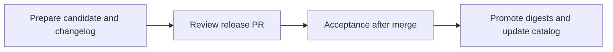

# Conforma release workflow

The release manifest identifies the exact artifacts that are tested and
published. Preparation resolves source tags once and assembles the final
Task/StepAction bundle. No artifact is rebuilt after acceptance.



## Prepare

Dispatch [Prepare release](../.github/workflows/prepare-release.yaml) on
`main` in `conforma/infra-deployments-ci`. It has two jobs:

1. `assemble` resolves the three policies, CLI, source Task bundle, source
   StepAction bundle, and external test inputs. It captures current destination
   digests and the catalog base commit, prepares definitions, and pushes the
   completed bundle under a unique `candidate-<UUID>` retention tag.
2. `changelog` runs the candidate CLI without publication credentials, compares
   the captured baseline and candidate, and produces the `release-pr-files`
   artifact.

Download `release-pr-files` and place its timestamped directory under
`releases/`. It contains `images.json` and `changelog.md`. Submit both in one
release PR. Preparation does not create or merge that PR.

All execution images are pinned to digests. Remote StepActions use full Git
commits or bundle digests, including conditional steps. If a dependency needs
changed YAML, preparation builds a retained dependency bundle first. The Task
bundle includes the prepared Tasks and StepActions. Unique retention tags must
be retained for the lifetime of their release records.

The manifest uses standard JSON. Its [annotated JSONC reference](RELEASE_WORKFLOW_V2_DESIGN.md#release-manifest)
documents intent without requiring comment-aware production parsers.
[The JSON Schema](release-manifest.schema.json) documents and validates field
types; the release tooling also checks known destinations and completeness.
Historical manifests without `schemaVersion: 2` are not publishable by this
workflow.

Preparation requires the existing `BUNDLE_PUSH_USER_CONFORMA` and
`BUNDLE_PUSH_PASS_CONFORMA` secrets. It uses no catalog write token.
Policy data sources in `hack/policy-behavior/golden-policy.yaml` are pinned to
OCI digests or full Git commits and directory paths; unsupported formats fail.

Private test inputs require `REGISTRY_READ_AUTH_JSON`, a Docker configuration
JSON secret containing **read-only** credentials. Preparation, comparison, and
acceptance use it; acceptance mounts it through a dedicated test service account.
The currently configured Golden RPM repository requires authenticated access.
For local checks, set `REGISTRY_AUTH_FILE` to a read-only Docker config and
`DOCKER_CONFIG` to its containing directory (the file must be `config.json`).

## Review and reproduce the changelog

Review image and source changes, policy rule changes, Golden image behavior,
and the Task/StepAction catalog diffs. Catalog diffs come from the exact files
in the final bundle compared with `catalog.baseCommit`.

The PR check validates the manifest, artifact availability, retention tags,
and execution references. It also checks newly introduced policy rules against
the recorded baseline: `effective_on` must be at least 56 days after the check.
Configure branch protection to require this check.

The local generator accepts a completed manifest:

```bash
python3 -m venv .venv
source .venv/bin/activate
pip install -r hack/release/requirements.txt

./hack/generate-changelog.sh releases/<id>/images.json
./hack/generate-changelog.sh releases/<id>/images.json /tmp/release-copy
./hack/generate-changelog.sh releases/<id>/images.json -

./hack/release.sh check releases/<id>/images.json
bash hack/check-release-lead-time.sh releases/<id>/images.json
```

Changelog generation also needs Bash, Git, `gh`, Go, `crane`, `jq`, Mike Farah
`yq`, and a container engine. Set `CONTAINER_ENGINE=podman` when appropriate.
The configured test commit must be available locally; use a full checkout.
For authenticated reads, the comparison helper supports `REGISTRY_AUTH_FILE`.

The same configuration commit supplies templates, collections, public key,
fixtures, and assertions for comparison and acceptance. Baseline and candidate
comparisons use the recorded targets, policy data, and comparison timestamp.
Behavior differences are informational. Operational failures and malformed
reports fail generation; partially written files are not a completed release.

## Acceptance

Merging a release PR triggers [konflux-policy](../.github/workflows/konflux-policy.yaml).
A push must select exactly one added or modified `images.json`. Ambiguous pushes
fail rather than silently selecting one. Manual dispatch on `main` selects a
release directory and runs the same checks.

The acceptance job has no registry or catalog write credentials. It:

- Verifies the complete bundle and its executable dependencies.
- Runs the Golden container and RPM through both verification Tasks, using the
  recorded CLI, release policy, targets, policy data, and configuration.
- Checks valid, populated TEST_OUTPUT reports in addition to PipelineRun success.
  Policy findings remain reviewable with `STRICT=false`; operational errors fail.
- Exercises the Trusted Artifacts VSA generation and archival path.
- Runs the auxiliary keyless-configuration Task script with missing, disabled,
  and enabled configuration.
- Runs the attestation StepAction script with successful and failed registry
  responses, asserting the statement and results. These script tests use the
  actual recorded runtime images and stub external commands.
- Evaluates positive and negative fixtures against the task and build-task
  policies, asserting specific rule results.

The fixture suite lists the released resource inventory. New released Tasks or
StepActions require explicit test cases. Test assertions live in the captured
configuration commit.

Acceptance records a fresh evaluation timestamp once per run. The
`release-acceptance` artifact contains its manifest hash, tested digests,
reports, fixture results, and logs. Failed runs save failure evidence but cannot
start publication. To run locally with the required container engine, Kind,
Kustomize, Go, and crane installed:

```bash
./hack/release.sh acceptance releases/<id>/images.json /tmp/acceptance-<unique-id>
```

On macOS with Podman, set `KIND_EXPERIMENTAL_PROVIDER=podman`. Publication requires
successful acceptance for the same manifest bytes.

## Publish

One job promotes the tested candidate. Releases are serialized, and a new
release cannot cancel active publication.

The destinations are the three Conforma policy `:konflux` tags, their three
`enterprise-contract` mirrors, the CLI `:konflux` tag, the final Task bundle
`:konflux` tag, and the Task/StepAction files on `conforma/tekton-catalog` branch
`konflux`.

Before writing anything, publication checks every destination tag and candidate
catalog path:

| Current value | Action |
| --- | --- |
| Candidate | Verify and skip |
| Recorded baseline | Apply candidate |
| Anything else, or read failure | Stop |

Image values are digests; catalog values are exact file bytes. An absent
baseline file permits addition only while that path remains absent. Missing
image tags are errors.

The job rechecks and copies image digests with `skopeo --all --preserve-digests`,
then applies pending catalog files on the current branch head and pushes without
force. Unrelated files and older catalog versions remain. Catalog deletions
require a separate reviewed change. Final verification checks all destinations.

The `publication-result` artifact records observed digests, the catalog commit,
manifest hash, workflow URL, and partial progress on failure. Registry and Git
updates are not one atomic transaction.

Publication uses the existing Conforma and enterprise-contract registry secret
pairs plus `EC_AUTOMATION_APP_ID` / `EC_AUTOMATION_KEY` for catalog writes.
All automation writing these release destinations must use the same process.

## Retry and rollback

For a partial failure, rerun the failed workflow or manually dispatch
`konflux-policy` with the same release directory. Acceptance is required before
publication. Already-applied tags and files are skipped; remaining baseline
values are updated. Recovery works even if a previous run failed to save its
result or lost the acknowledgement of a successful Git push.

A conflict means the release is stale or a destination was changed independently.
Inspect current state and prepare a new reviewed manifest. Do not rewrite an
old release record or bypass the checks.

A deliberate rollback is a new reviewed version 2 manifest: select retained
historical candidate digests, capture current tag and catalog baselines, choose
the test configuration, regenerate the changelog, and run the ordinary acceptance
and publication workflow. Replaying an old manifest does not bypass stale-state
checks. Historical version 1 releases require recovering the actual published
CLI and final bundle from their original run records before constructing a
version 2 rollback manifest.

## Separate infra-deployments update

[create-pr.yaml](../.github/workflows/create-pr.yaml) remains a separate maintenance
flow. This release ends with registry tags and catalog updates; it does not
change the infra-deployments PR process or verify rollout to production clusters.
