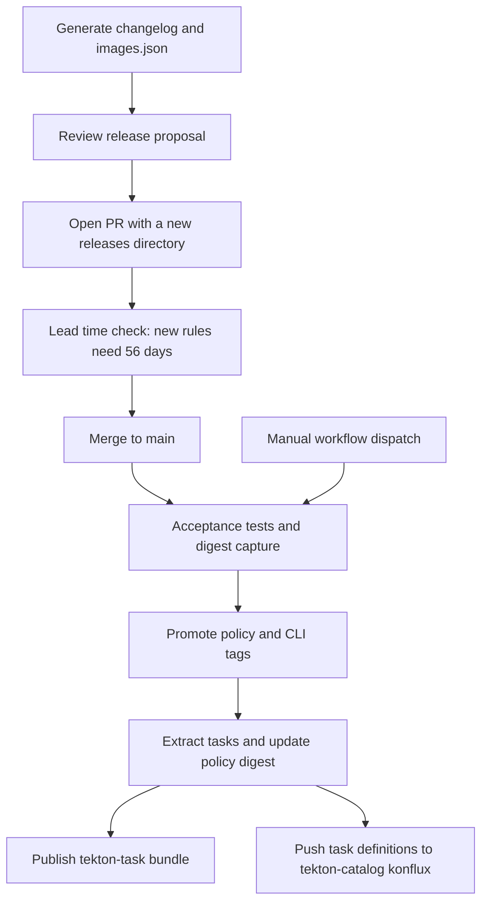

# Conforma release workflow

The Conforma release is executed by GitHub Actions in [`.github/workflows/konflux-policy.yaml`](../.github/workflows/konflux-policy.yaml). Engineers use [`hack/generate-changelog.sh`](../hack/generate-changelog.sh) to prepare the release notes and image manifest for review; that local script does not perform the release or promote images. This guide covers preparation, review, workflow execution, and publication of policies, the CLI image, Tekton tasks, and catalog definitions.

## At a glance



The normal path starts with preparing and reviewing a new directory under `releases/`, then merging it to `main`. That push starts the `konflux-policy` workflow, which runs the release. Engineers can also start the workflow manually against an existing release directory. Its scheduled trigger is currently commented out. There is no local command that performs the release publication steps.

## 1. Prepare release inputs locally

Run the generator from the repository root:

```bash
./hack/generate-changelog.sh
```

By default, the script creates a UTC timestamped directory such as `releases/2026-10-21T15:30:00/` containing:

| File | Contents and use |
|---|---|
| `changelog.md` | Candidate image digests, source pull requests, policy rule changes, and policy behavior comparison. This is for human review. |
| `images.json` | Candidate image digests and policy mirror destinations. The release workflow reads this file to select policy images for promotion. |

You can provide an output directory explicitly:

```bash
./hack/generate-changelog.sh releases/my-candidate
```

The `-` argument writes the changelog to stdout and does not keep an `images.json` file:

```bash
./hack/generate-changelog.sh -
```

Use a new directory under `releases/` when preparing a release for the automatic push trigger. This is the local preparation step only: the generator does not commit files, open a PR, run the acceptance workflow, or publish images. The actual release starts when GitHub Actions runs `konflux-policy` after the release directory is merged, or when an engineer dispatches that workflow manually.

### Local prerequisites

Install Bash, Git, GitHub CLI (`gh`), Go, `crane`, `jq`, Mike Farah `yq`, and Docker or Podman. The container engine must be running and able to pull the target images from Quay. Docker is the default; select Podman with:

```bash
export CONTAINER_ENGINE=podman
```

Anonymous Quay pulls are normally sufficient. If registry authentication is required, set `REGISTRY_AUTH_FILE` to a Docker-compatible auth file. The helper mounts it read-only in the validation container. Set `REGISTRY_AUTH_DEST` if the container engine expects the file at another path. `gh` is used to look up source PR titles; a lookup failure leaves the PR number in the changelog with `(title unavailable)`.

### What the generator compares

The script records candidate digests for five Conforma images at `:latest`. It compares source revisions for `release-policy` and `cli`, and compares rule contents for all three policy images, using `:konflux` as the current release and `:latest` as the candidate:

| Candidate image | Destination for a policy mirror tag |
|---|---|
| `quay.io/conforma/release-policy` | `quay.io/enterprise-contract/ec-release-policy` |
| `quay.io/conforma/task-policy` | `quay.io/enterprise-contract/ec-task-policy` |
| `quay.io/conforma/build-task-policy` | `quay.io/enterprise-contract/ec-build_task-policy` |
| `quay.io/conforma/cli` | None listed in the release manifest. |
| `quay.io/conforma/tekton-task` | None listed in the release manifest. |

The changelog contains three kinds of information:

1. **Images:** registry digests for the candidates.
2. **Source changes:** merge commits and PR titles between the image revision annotations for `release-policy` and `cli`. The script clones `conforma/policy` and `conforma/cli` and compares their source revisions. It picks the linux/amd64 manifest for multi-architecture images. This is a merge-commit summary, not a full list of all commits.
3. **Policy changes:** [`hack/policy-rule-diff`](../hack/policy-rule-diff/) compares each policy image and renders added and removed `deny` and `warn` rules, including descriptions, collections, effective dates, and documentation links.

The generator resolves candidate `:latest` references more than once. The image list at the top of `changelog.md`, the source and policy comparisons, and the final `images.json` can therefore differ if a mutable tag moves while generation is running. Check that the reported digests agree before submitting the release.

## 2. Review policy behavior changes

The generator runs [`hack/policy-behavior/compare-policy-behavior.sh`](../hack/policy-behavior/compare-policy-behavior.sh) and appends its results to the changelog. It validates two target images against current and candidate releases, for four `ec validate image` runs total.

| Input | Current release | Candidate release |
|---|---|---|
| CLI | `quay.io/conforma/cli:konflux` | CLI digest from the generated `images.json` |
| Release policy | `quay.io/conforma/release-policy:konflux` | Release policy digest from `images.json` |
| Targets | Golden container and Golden RPM, each resolved to an immutable digest | The same resolved target digests |
| Effective time | One UTC timestamp | The same timestamp |

[`targets.json`](../hack/policy-behavior/targets.json) defines the targets and collections: Golden container uses `@redhat`, and Golden RPM uses `@redhat_rpms`. The RPM comparison target is configured with an `on-pr-...calculation-x86_64` image tag; the acceptance scenarios use the RPM `:latest` tag.

The helper renders [`golden-policy.yaml`](../hack/policy-behavior/golden-policy.yaml) with the release policy and target collection for each run. That template uses `oci::quay.io/redhat-konflux/policy-data:latest` as policy data, and validation uses [`acceptance/pub.key`](../acceptance/pub.key). The command uses `--strict=false`, `--show-warnings`, `--info`, `--ignore-rekor`, `--allow-past-effective-time`, `--effective-time`, `--timeout 30m`, and JSON output.

The report compares violations and warnings per target. It identifies results by `metadata.code` when available and otherwise by message, deduplicating repeated results across image components. If a rule changes from warning to violation, the report shows both a removed warning and an added violation.

Behavior differences are for reviewers and do not fail generation by themselves. Failed image pulls, invalid configuration, command failures, or malformed JSON reports do fail generation. The generator writes the release files before this comparison, so files may remain even if the command exits with an error. Treat the exit status and a complete behavior section as part of a successful generation.

Review the candidate digests, source PRs, rule effective dates, behavior changes, and mirror destinations. Regenerate or investigate if a comparison fails or candidate digests disagree.

## 3. Open a release PR

Commit `changelog.md` and `images.json` together in one new release directory, then open a PR against `main` in `conforma/infra-deployments-ci`.

The [`check-release-lead-time` workflow](../.github/workflows/check-release-lead-time.yaml) runs for PRs to `main` that change `releases/**`. It checks each added or modified release manifest using [`hack/check-release-lead-time.sh`](../hack/check-release-lead-time.sh). For each policy image, the helper compares the pinned candidate digest in `images.json` with the current `:konflux` image. Newly added rules must have an RFC3339 `effective_on` date at least **56 days after the check runs**. Existing rules are exempt. A new rule with a missing, malformed, or too-soon date fails the check.

You can run the same check locally:

```bash
bash ./hack/check-release-lead-time.sh releases/<release-directory>/images.json
```

The generator does not run this check. The publication workflow does not repeat it. GitHub branch protection determines whether the check must pass before merge; the workflow definition alone does not establish that requirement. [`CODEOWNERS`](../.github/CODEOWNERS) assigns repository paths to `@conforma/devs`, but approval requirements are set separately.

## 4. Merge and start publication

The [`konflux-policy` workflow](../.github/workflows/konflux-policy.yaml) starts on either:

- A push to `main` that changes files under `releases/**`.
- A manual `workflow_dispatch` run with a release directory selected.

For a push, it chooses the first newly added `releases/*/images.json` in the pushed commit range. For predictable selection, merge one new release directory per push. Changing an existing release directory or changing only `changelog.md` still matches the path trigger but does not add a new manifest, so the workflow fails with `No images.json found`. Use manual dispatch to rerun an existing release directory.

The workflow has five jobs:

| Job | Role |
|---|---|
| `acceptance-tests` | Reads the release manifest, captures tested image digests, and runs the acceptance suite. |
| `tag` | Promotes policy digests and the CLI digest to `:konflux`. |
| `update-task-definitions` | Extracts tasks from the captured task bundle, updates the policy digest, and uploads the resulting YAML files. |
| `tekton-task-bundle` | Rebuilds the task bundle from the prepared YAML files and moves its `:konflux` tag. |
| `tekton-catalog` | Pushes prepared task definitions to the catalog's `konflux` branch. |

All publication jobs are restricted to the canonical `conforma/infra-deployments-ci` repository. The workflow's schedule is commented out with a release-freeze and `ITN-2026-00051` note.

## 5. Acceptance tests and captured digests

The `acceptance-tests` job reads `images.json`, installs Go, `crane`, `yq`, and Kind, runs [`hack/resolve-tested-digests.sh`](../hack/resolve-tested-digests.sh), then runs:

```bash
make acceptance
```

The resolver scans `acceptance/conforma*.yaml` for Tekton bundle references. It resolves the task bundle tag to a digest, reads the `verify-enterprise-contract` task from the bundle, and pins the CLI image referenced by its first step. The digest map is passed to downstream jobs.

The acceptance suite creates a temporary Kind cluster with Tekton Pipelines, the EnterpriseContractPolicy CRD, and a local OCI registry. Four scenarios validate Golden container and Golden RPM inputs through both `verify-enterprise-contract` and `verify-conforma-konflux-ta`. The Trusted Artifacts scenarios prepare the input snapshot and publish it to the local registry. The tests check that the Tekton pipelines complete successfully with `STRICT=false`; they do not require that policy reports contain zero violations.

**Digest limitation:** although the resolver captures bundle and CLI digests, the acceptance scenarios still refer to `quay.io/conforma/tekton-task:latest` and `quay.io/conforma/release-policy:latest`. The captured digest map is used for downstream promotion and task extraction, but it is not passed into those test scenarios. Therefore, successful acceptance tests do not prove that the exact candidate digests in the reviewed release manifest were tested. The acceptance policy data sources also differ from the local behavior comparison: scenarios use `git::github.com/release-engineering/rhtap-ec-policy//data` and `oci::quay.io/konflux-ci/tekton-catalog/data-acceptable-bundles:latest`.

## 6. Promote policy and CLI images

After acceptance succeeds, the `tag` job logs in to `quay.io/conforma` and `quay.io/enterprise-contract` using repository secrets. It uses `skopeo copy --all` to copy each policy digest in the release manifest to that image's Conforma `:konflux` tag and to any configured mirror `:konflux` tags.

The same job promotes the CLI image digest extracted from the tested task bundle to the CLI repository's `:konflux` tag. It excludes the task bundle from this direct retagging. The `components` entries in `images.json` are not used to choose the CLI or task bundle promoted by this workflow.

## 7. Rebuild and publish task definitions

After acceptance and tagging, `update-task-definitions` uses the pinned task bundle digest from the acceptance job. [`hack/extract-all-bundle-tasks.sh`](../hack/extract-all-bundle-tasks.sh) extracts every task from the bundle, including tasks not covered by the current acceptance scenarios. Each task must have an `app.kubernetes.io/version` label. The output follows the catalog layout `tasks/<task-name>/<version>/<task-name>.yaml`.

Next, [`hack/update-policy-digest.sh`](../hack/update-policy-digest.sh) resolves the current `quay.io/conforma/release-policy:konflux` digest and updates task YAML defaults named `POLICY_BUNDLE_DIGEST`. This is a fresh registry lookup. The workflow uploads the prepared files as the `task-definitions` artifact.

Two jobs consume that artifact independently:

| Job | Result |
|---|---|
| `tekton-task-bundle` | Uses `tkn bundle push` to publish `quay.io/conforma/tekton-task:run-<UTC-date>-<run-id>-<attempt>`, then moves `:konflux` to the same bundle. The unique run tag preserves the bundle digest. |
| `tekton-catalog` | Copies task YAML into `conforma/tekton-catalog` and pushes a commit directly to its `konflux` branch. It does not open a PR. If no files changed, the job exits successfully without a commit. |

The catalog job uses a GitHub App with write access to `tekton-catalog`. The commit message includes the workflow run URL. The bundle is rebuilt after acceptance to include the policy digest update; the rebuilt bundle is not tested again in this workflow. Catalog and bundle publication can succeed or fail independently.

## 8. Manual dispatch, completion, and recovery

The `konflux-policy` manual dispatch form has these inputs:

| Input | Behavior |
|---|---|
| `release_dir` | Required. Accepts a directory name or a path beginning with `releases/`. |
| `run_tag` | Promote policy and CLI tags. Defaults to `true`. |
| `run_tekton_task_bundle` | Publish the rebuilt task bundle. Defaults to `true`. |
| `run_tekton_catalog` | Publish task YAML to the catalog branch. Defaults to `true`. |

Set all three switches to false to run acceptance only. If `run_tag` is false while either publication switch is true, task preparation can still run after acceptance; it uses the existing `release-policy:konflux` digest when updating task definitions. A manual run using an old manifest does not recreate a complete historical release: it resolves the current task bundle again.

For a full release, check the workflow run and Quay/catalog results:

- Acceptance tests, tagging, task preparation, bundle publication, and catalog publication completed successfully (or the catalog job reported no changes).
- Policy `:konflux` and mirror tags point to the manifest digests.
- CLI `:konflux` matches the CLI digest reported by the resolver.
- Task bundle `:konflux` points to the unique `run-...` tag for the run; the bundle includes the intended policy digest defaults.
- The catalog `konflux` branch contains the prepared task definitions.
- Keep the release PR, release directory, and workflow run URL as the release record.

The workflow does not provide transactional rollback or a release-wide concurrency guard. A later job can fail after earlier image tags have moved. Inspect which jobs completed and the current destination tags before retrying selected jobs. A catalog failure does not undo a successfully published task bundle.

## Separate infra-deployments update

The [`create-pr` workflow](../.github/workflows/create-pr.yaml) is a separate maintenance flow. It runs manually or on Fridays at 10:00 UTC. It checks out `infra-deployments`, `conforma/cli`, `conforma/crds`, and `conforma/config`, runs each source repository's update helper, then uses [`hack/create-pr.sh`](../hack/create-pr.sh) to propose changes to `infra-deployments` on the `ec-batch-update` branch. It does not read the release directory and is not called by `konflux-policy`.

This workflow proposes an infra-deployments change; it does not deploy it. The CLI helper resolves the task bundle's current `:latest` tag, while the config helper regenerates policy configuration from the config repository. This is not guaranteed to select the exact images listed in a release manifest. The `konflux-policy` workflow itself ends with image tags and catalog branch updates; it does not create a GitHub Release, send release announcements, or verify rollout to production clusters.
