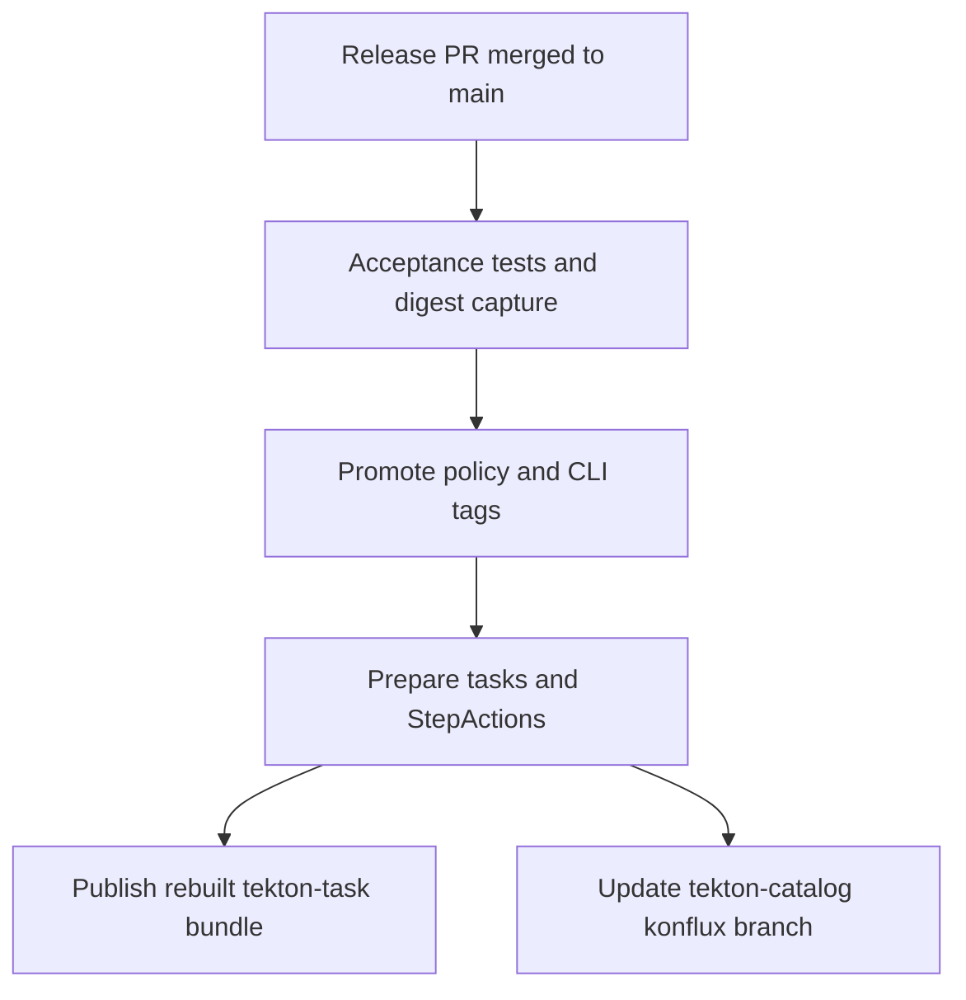

# Phase 1: Publish a Conforma release

The Conforma team owns this phase in `conforma/infra-deployments-ci`. It publishes
policy and CLI images, a rebuilt Tekton bundle, and task and StepAction definitions
in `conforma/tekton-catalog`. After publication, continue with
[Phase 2: Roll out the release in Konflux](KONFLUX_ROLLOUT.md).

**Published is not the same as deployed.** `:konflux` is a release channel, not an
environment rollout status. Floating references can pick up new tags on their
next resolution; digest- and commit-pinned consumers need separate updates.

## 1. Prepare and review the release

From the repository root, run:

```bash
./hack/generate-changelog.sh
```

The [generator](../hack/generate-changelog.sh) creates a UTC-timestamped directory
under `releases/`. It prepares files locally; it does not commit, open a PR or
publish anything.

| File | Purpose |
| --- | --- |
| `changelog.md` | Candidate image digests, source PRs, policy rule changes and behavior comparison for review. |
| `images.json` | Candidate digests and policy mirror destinations. Publication uses its `policy` entries; see [how component inputs are selected](#what-acceptance-establishes). |

An explicit new directory can be passed as an argument. `-` prints the changelog
without retaining an `images.json` file.

Prerequisites: Bash, Git, `gh`, Go, `crane`, `jq`, Mike Farah `yq`, and a running
Docker or Podman engine. Set `CONTAINER_ENGINE=podman` for Podman. Registry access
must cover the Golden test images as well as Conforma images. If needed, provide
`REGISTRY_AUTH_FILE` with Docker-compatible credentials; see the
[generator prerequisites](../README.md#prerequisites).

Review the following before submitting:

- Candidate digests and source changes relative to `:konflux`. The generator
  resolves mutable `:latest` tags more than once, so check that the changelog and
  manifest agree.
- Added/removed policy rules, effective dates, collections and mirror destinations.
- The policy behavior comparison. It validates Golden container and Golden RPM
  against current and candidate CLI/policy pairs, using the same resolved target
  digests and effective time. Targets and collections are in
  [`targets.json`](../hack/policy-behavior/targets.json); comparison logic is in
  [`compare-policy-behavior.sh`](../hack/policy-behavior/compare-policy-behavior.sh).

Behavior differences are review information, not a generation failure.
Pull/configuration/command/report errors are failures. Release files are written
before the comparison, so their presence alone does not mean generation succeeded.

Open a PR to `main` with both files in **one new release directory**. The
[lead-time check](../.github/workflows/check-release-lead-time.yaml) requires newly
added policy rules to have a valid RFC3339 `effective_on` at least **56 days after
the check runs**. Existing rules are exempt. To run the same check locally:

```bash
RELEASE_DIR='releases/<release-directory>'
bash ./hack/check-release-lead-time.sh "$RELEASE_DIR/images.json"
```

The generator and publication workflow do not run this check themselves. Confirm
the PR checks and required reviews before merging.

## 2. Run publication

The [`konflux-policy` workflow](../.github/workflows/konflux-policy.yaml) runs on a
push to `main` changing `releases/**`, or by manual dispatch. Publication jobs run
only in the canonical `conforma/infra-deployments-ci` repository. Its scheduled
trigger is currently commented out.

For a push, the workflow selects the **first newly added** `releases/*/images.json`
in the pushed commit range. Merge one release directory at a time. Editing an
existing release or only its changelog matches the trigger but supplies no new
manifest and fails with `No images.json found`. Use manual dispatch for an existing
directory.

The normal full-publication path is:



| Workflow job | What it does |
| --- | --- |
| `acceptance-tests` | Reads the manifest, [captures bundle/CLI digests](../hack/resolve-tested-digests.sh), then runs `make acceptance` on a temporary Kind cluster. |
| `tag` | Copies manifest policy digests to Conforma and configured mirror `:konflux` tags with `skopeo copy --all`. Promotes the CLI extracted from the captured task bundle. |
| `update-task-definitions` | [Extracts resources](../hack/extract-bundle-resources.sh) from the captured task bundle, [updates `POLICY_BUNDLE_DIGEST` defaults](../hack/update-policy-digest.sh) from the current `release-policy:konflux` digest, and extracts StepActions from `quay.io/conforma/step-actions:snapshot`. Uploads the combined `task-definitions` artifact. |
| `tekton-task-bundle` | Bundles the prepared resources under `quay.io/conforma/tekton-task:run-<UTC-date>-<run-id>-<attempt>`, then moves `:konflux` to that bundle. |
| `tekton-catalog` | Copies the prepared `tasks/` and `stepactions/` into `conforma/tekton-catalog` and pushes directly to `konflux`, without a PR. A no-change result is valid. |

The final two jobs consume the same artifact but can succeed or fail independently.

### What acceptance establishes

The [Golden](../features/validate_golden.feature) and
[Trusted Artifacts](../features/validate_golden_ta.feature) scenarios cover container
and RPM inputs with `STRICT=false`. They check pipeline completion, not zero policy
violations. Their policy-data sources also differ from the local behavior comparison.

The current workflow is not a replay of all candidate digests in `images.json`:

- The manifest selects **policy** digests. Its `components` entries do not select
  the promoted CLI or final task bundle; those come from the captured bundle and
  subsequent rebuild.
- Acceptance scenarios still use `:latest` references. The captured digest map is
  not injected into them, so a green run does not prove the exact reviewed
  candidate was tested.
- StepActions are resolved separately from `:snapshot`. The final combined bundle
  is rebuilt after acceptance and is not tested again by this workflow.

Use the actual publication outputs for the downstream handoff, not guessed
component digests from the proposal.

### Manual dispatch

Use the [workflow's Actions page](https://github.com/conforma/infra-deployments-ci/actions/workflows/konflux-policy.yaml).

| Input | Meaning |
| --- | --- |
| `release_dir` | Required existing directory, with or without the `releases/` prefix. |
| `run_tag` | Publish policy and CLI tags. Default: `true`. |
| `run_tekton_task_bundle` | Publish the rebuilt bundle. Default: `true`. |
| `run_tekton_catalog` | Update the catalog branch. Default: `true`. |

Setting all three switches to `false` runs acceptance only. If `run_tag=false` but
resource publication is enabled, task preparation uses the **existing**
`release-policy:konflux` digest. Inspect the intended combination before dispatching.

## 3. Verify publication and record the handoff

Check individual job results, not just the overall workflow conclusion: optional
publication jobs can be skipped. For a full release, all five jobs must complete
successfully, allowing a no-change catalog result.

Keep the release PR, directory and workflow run URL together with these outputs:

| Output to record | Source of truth and verification |
| --- | --- |
| Policy digests and mirrors | `images.json` `policy` entries, confirmed against successful tag-job logs and destination tags. |
| Published CLI digest | Resolver/tag-job output, confirmed against `quay.io/conforma/cli:konflux`. Not necessarily the candidate CLI digest. |
| Published task-bundle digest and `run-...` tag | Successful bundle-job output. Confirm the run tag and `quay.io/conforma/tekton-task:konflux` resolve to the same digest. |
| Full `conforma/tekton-catalog` commit SHA | The successful catalog job and `konflux` branch. The generated commit includes the run URL; if nothing changed, record the existing revision. |

Use `crane digest <reference>` to check registry destinations. Check that the
published task definitions contain the intended policy digest defaults. These
records identify the release even after mutable tags or branch heads advance.

The workflow does not write final CLI/bundle digests back into `images.json`.
Preserve them while logs and run tags are available; registry cleanup can remove
old run tags. Then start the [Konflux handoff](KONFLUX_ROLLOUT.md#1-handoff).
Publication alone does not verify production adoption or send a release announcement.

## 4. Recover from a partial publication or roll back

Publication is not transactional and has no release-wide concurrency guard.
Coordinate runs: a failed or delayed run can leave some destinations updated or
overwrite a newer release. Before retrying, inspect completed jobs, current tags,
the catalog branch and any downstream pins already updated. A catalog failure does
not undo a successful bundle publication.

**Do not dispatch an old `release_dir` as a rollback.** It resolves current bundle
inputs again; it does not reproduce the old published artifacts.

For a rollback:

1. Select a previous fully published release. Recover policy digests from its
   manifest, the actual CLI digest from its successful tag-job log, and the final
   bundle from its successful bundle-job log/run tag. Use the
   [handoff record](#3-verify-publication-and-record-the-handoff) if retained.
2. With approved registry access, restore each required policy tag and every mirror
   listed in that manifest. For example:

   ```bash
   IMAGE=quay.io/conforma/release-policy
   DIGEST='sha256:<verified-previous-digest>'
   MIRROR=quay.io/enterprise-contract/ec-release-policy
   skopeo copy --all "docker://${IMAGE}@${DIGEST}" "docker://${IMAGE}:konflux"
   skopeo copy --all "docker://${IMAGE}@${DIGEST}" "docker://${MIRROR}:konflux"
   ```

   Restore the CLI with the same digest-copy operation, using its verified
   published digest. Restore the task bundle from the verified previous run tag:

   ```bash
   BUNDLE_TAG='run-<UTC-date>-<run-id>-<attempt>'
   crane digest "quay.io/conforma/tekton-task:${BUNDLE_TAG}"
   crane tag "quay.io/conforma/tekton-task:${BUNDLE_TAG}" konflux
   ```

3. Verify all restored tag digests. Restore catalog task/StepAction definitions
   separately if needed; registry retagging does not change Git.
4. Coordinate [downstream pin restoration](KONFLUX_ROLLOUT.md#5-rollback) with Konflux
   maintainers. Moving tags or reverting catalog content does **not** change
   existing digest- or SHA-pinned consumers. Record recovery evidence from new runs.

## Separate configuration maintenance

The [`create-pr` workflow](../.github/workflows/create-pr.yaml) is a separate
infra-deployments maintenance flow. It does not read the release directory and is
not called by `konflux-policy`. Do not treat its `ec-batch-update` PR as the next
step of this release; the consumer updates are covered in
[Phase 2](KONFLUX_ROLLOUT.md).
