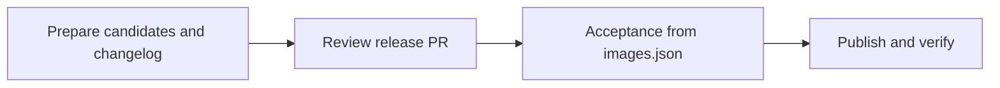

# Conforma release workflow design

Status: implemented in this branch. `RELEASE_WORKFLOW.md` is the operator guide.

## Release contract

Pin the inputs once, including source Task bundles and StepActions, and
assemble the final Task bundle before acceptance. The completed `images.json`
identifies the exact candidate that both testing and publication consume.

The release includes all of these outputs:

| Destination | Released content |
| --- | --- |
| `quay.io/conforma/release-policy:konflux` | Candidate release policy digest |
| `quay.io/conforma/task-policy:konflux` | Candidate Task policy digest |
| `quay.io/conforma/build-task-policy:konflux` | Candidate build Task policy digest |
| The three corresponding `quay.io/enterprise-contract/*:konflux` mirrors | Copies of those policy digests |
| `quay.io/conforma/cli:konflux` | Candidate CLI digest |
| `quay.io/conforma/tekton-task:konflux` | Final Task and StepAction bundle digest |
| `conforma/tekton-catalog`, branch `konflux` | Task and StepAction files extracted from that final bundle |

The source Task and StepAction bundles are preparation inputs. A unique
retention tag keeps each newly built bundle available after `:konflux` moves.
The separate `infra-deployments` PR workflow remains outside this release.



After preparation, no stage rebuilds an artifact, changes its definitions,
or selects a newer source tag. Destination reads check publication state and
never replace a recorded candidate.

## Release manifest

Keep `images.json` with `schemaVersion: 2` and the existing `policy` and
`components` arrays. Store the release-specific values that later steps need:

| Field | Purpose |
| --- | --- |
| `policy` | Three candidate policy digests and their mirror repositories |
| `components` | Candidate CLI and final Task bundle digests |
| `inputs.sourceTaskBundle`, `inputs.stepActionsBundle` | Captured source versions for preparation history and the changelog |
| `inputs.testInputs` | One configuration commit, external test image/data pins, and comparison timestamp |
| `catalog` | Destination repository/branch and the commit providing previous file contents |
| `baseline.images` | Expected previous digest of every destination tag, including mirrors |

`image` means a repository without a tag or digest. An artifact is selected
using `image@digest`. Policy mirrors receive `:konflux`. Newly built artifacts
also have `retentionTag`, a unique tag in that repository which must continue
to point to the recorded digest. Testing and publication use the digest.

Standard JSON does not support comments. Generated `images.json` files remain
strict JSON so existing parsers can read them. This documentation uses JSONC
(JSON with comments) to explain each field; the comments are not emitted into
release manifests. Repeated fields have the same meaning unless stated
otherwise. Keep this reference in sync when changing the schema.

The following example abbreviates the baseline list; actual manifests require
an entry for all eight `:konflux` destinations. Hashes and timestamps are
placeholders.

```jsonc
{
  // Selects the manifest format and its validation/publication rules.
  "schemaVersion": 2,

  // The three policy artifacts that acceptance tests and publication promotes.
  "policy": [
    {
      // Canonical OCI repository, without a tag or digest.
      "image": "quay.io/conforma/release-policy",
      // Exact candidate content, selected during preparation.
      "digest": "sha256:...",
      // Additional repositories that receive the same digest at :konflux.
      "mirrors": ["quay.io/enterprise-contract/ec-release-policy"]
    },
    {"image": "quay.io/conforma/task-policy", "digest": "sha256:...", "mirrors": ["quay.io/enterprise-contract/ec-task-policy"]},
    {"image": "quay.io/conforma/build-task-policy", "digest": "sha256:...", "mirrors": ["quay.io/enterprise-contract/ec-build_task-policy"]}
  ],

  // Executable release artifacts. Both are promoted unchanged after acceptance.
  "components": [
    // The CLI embedded in the prepared Task/StepAction definitions.
    {"image": "quay.io/conforma/cli", "digest": "sha256:..."},
    {
      // The completed bundle, including the prepared Tasks and StepActions.
      "image": "quay.io/conforma/tekton-task",
      "digest": "sha256:...",
      // Keeps this build available after :konflux moves; never used for selection.
      "retentionTag": "candidate-<preparation-id>"
    }
  ],

  // Captured preparation sources and shared test inputs.
  "inputs": {
    // Original Task definitions before CLI/policy updates and reference pinning.
    "sourceTaskBundle": {"image": "quay.io/conforma/tekton-task", "digest": "sha256:..."},
    // Original StepAction definitions included during final bundle assembly.
    "stepActionsBundle": {"image": "quay.io/conforma/step-actions", "digest": "sha256:..."},

    // Makes changelog comparisons and acceptance use consistent test inputs.
    "testInputs": {
      // Full commit of this repository supplying templates, key, fixtures,
      // target collections, and assertions from their standard paths.
      "configCommit": "...",
      // External images to evaluate, frozen even if their source tags move.
      "targets": [
        {
          // Stable scenario identifier used by the test configuration.
          "name": "golden-container",
          "image": "quay.io/konflux-ci/ec-golden-image",
          "digest": "sha256:..."
        },
        {"name": "golden-rpm", "image": "quay.io/redhat-user-workloads/rhtap-contract-tenant/golden-rpm/golden-rpm", "digest": "sha256:..."}
      ],
      // Auxiliary policy data: OCI references pinned to digests.
      "policyData": ["oci::quay.io/redhat-konflux/policy-data@sha256:..."],
      // One evaluation time for both sides of the changelog comparison.
      // Acceptance records its own fresh evaluation time with the results.
      "comparisonTime": "<RFC3339 timestamp>"
    }
  },

  // Where exact resource files from the tested final bundle are published.
  "catalog": {
    // GitHub owner/repository receiving the Task and StepAction definitions.
    "repository": "conforma/tekton-catalog",
    // Destination branch for catalog additions and updates.
    "branch": "konflux",
    // Full commit captured during preparation. Supplies previous file contents
    // for the changelog and conflict checks; branch HEAD may advance safely.
    "baseCommit": "..."
  },

  // Previous release state used to detect stale candidates and allow retries.
  "baseline": {
    // One entry for each of the eight canonical/mirror destination tags.
    "images": [
      {
        // Full destination reference, including its mutable release tag.
        "reference": "quay.io/conforma/release-policy:konflux",
        // Digest observed there during preparation, not the candidate digest.
        // Publication permits either this value or the already-applied candidate.
        "digest": "sha256:..."
      }
    ]
  }
}
```

## Implementation

Use the existing Bash, jq, yq, crane and Tekton helpers. There is no separate
release framework or acceptance protocol.

1. `prepare-release.sh` captures the candidates, test inputs and publication
   baselines. It extracts the source bundles, updates CLI and policy defaults,
   pins execution images and Git StepAction commits, and pushes the completed
   bundle under a unique retention tag. External Git StepActions must already
   pin their runtime images; unsupported resolvers fail with an explicit error.
   Fix upstream definitions rather than building extra dependency bundles.
2. `generate-changelog.sh` reads the completed manifest. It compares policy
   rules and Golden image behavior against the recorded baseline, and compares
   exact files extracted from the final bundle against the catalog base commit.
   Configuration comes from `git archive` at `configCommit`.
3. After the release PR merges, the existing Go acceptance suite reads
   `RELEASE_IMAGES`. GitHub Actions checks out `configCommit` normally, so its
   tests, fixtures, key and templates all come from that commit. Both verification
   Tasks use the final bundle; all policy and test image inputs use manifest
   digests. Auxiliary Task/StepAction script cases and positive/negative task
   policy cases are ordinary Go tests. Reports and logs are saved as artifacts.
4. The publication job has `needs: acceptance` and reads the same manifest path
   at the same workflow commit. `publish-release.sh` promotes the recorded
   digests and copies exact final-bundle files to the catalog. No acceptance
   certificate, manifest hash handshake, generated test tree or post-test build
   is needed.

The PR check validates the manifest and prepared definitions and retains the
56-day policy lead-time check against the recorded baseline. Version 1 records
remain historical; they cannot enter the version 2 publication path.

## Publication and recovery

Before any write, check all eight destination tags and each candidate catalog
path. Recheck immediately before applying changes:

| Current value | Action |
| --- | --- |
| Candidate digest or exact file bytes | Verify and skip |
| Recorded baseline digest or file bytes | Apply candidate |
| Anything else, or read failure | Stop |

A new catalog path must still be absent. Missing image tags are errors. Unrelated
catalog files and old versions remain unchanged. Copy images with
`skopeo --all --preserve-digests`; push catalog commits without force. After a
rejected push or lost acknowledgement, fetch and compare actual contents before
retrying. Verify all destinations at the end and retain the publication log.

Serialize the workflow and never cancel active publication. Registry and Git
updates are not atomic; rerun the same release to finish a partial publication.
A stale release or deliberate rollback requires a newly reviewed manifest with
current baselines. Recovery uses destination state, not a previous run's log.

See [the operator guide](RELEASE_WORKFLOW.md) for commands, credentials and
coverage. New released resources require explicit acceptance cases.
