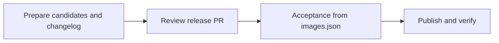

# Conforma release workflow design

Status: implemented in this branch. `RELEASE_WORKFLOW.md` is the operator guide.

## Release contract

Pin the inputs once, including source Task bundles and StepActions, and
assemble the final Task bundle before acceptance. The completed `images.json`
identifies the exact candidate that both testing and publication consume.

The release includes all of these outputs:

| Destination | Released content |
| --- | --- |
| `quay.io/conforma/release-policy:konflux` | Candidate release policy digest |
| `quay.io/conforma/task-policy:konflux` | Candidate Task policy digest |
| `quay.io/conforma/build-task-policy:konflux` | Candidate build Task policy digest |
| The three corresponding `quay.io/enterprise-contract/*:konflux` mirrors | Copies of those policy digests |
| `quay.io/conforma/cli:konflux` | Candidate CLI digest |
| `quay.io/conforma/tekton-task:konflux` | Final Task and StepAction bundle digest |
| `conforma/tekton-catalog`, branch `konflux` | Task and StepAction files extracted from that final bundle |

The source Task and StepAction bundles are preparation inputs. A unique
retention tag keeps each newly built bundle available after `:konflux` moves.
The separate `infra-deployments` PR workflow remains outside this release.



After preparation, no stage rebuilds an artifact, changes its definitions,
or selects a newer source tag. Destination reads check publication state and
never replace a recorded candidate.

## Release manifest

Keep `images.json` with `schemaVersion: 2` and the existing `policy` and
`components` arrays. Store the release-specific values that later steps need:

| Field | Purpose |
| --- | --- |
| `policy` | Three candidate policy digests and their mirror repositories |
| `components` | Candidate CLI and final Task bundle digests |
| `inputs.sourceTaskBundle`, `inputs.stepActionsBundle` | Captured source versions for preparation history and the changelog |
| `inputs.dependencyBundles` | Optional list of extra bundles actually built during preparation, for retention |
| `inputs.testInputs` | One configuration commit, external test image/data pins, and comparison timestamp |
| `catalog` | Destination repository/branch and the commit providing previous file contents |
| `baseline.images` | Expected previous digest of every destination tag, including mirrors |

`image` means a repository without a tag or digest. An artifact is selected
using `image@digest`. Policy mirrors receive `:konflux`. Newly built artifacts
also have `retentionTag`, a unique tag in that repository which must continue
to point to the recorded digest. Testing and publication use the digest.

Standard JSON does not support comments. Generated `images.json` files remain
strict JSON so existing parsers can read them. This documentation uses JSONC
(JSON with comments) to explain each field; the comments are not emitted into
release manifests. Repeated fields have the same meaning unless stated
otherwise. Keep this reference in sync when changing the schema.

The following example abbreviates the baseline list; actual manifests require
an entry for all eight `:konflux` destinations. Hashes and timestamps are
placeholders.

```jsonc
{
  // Selects the manifest format and its validation/publication rules.
  "schemaVersion": 2,

  // The three policy artifacts that acceptance tests and publication promotes.
  "policy": [
    {
      // Canonical OCI repository, without a tag or digest.
      "image": "quay.io/conforma/release-policy",
      // Exact candidate content, selected during preparation.
      "digest": "sha256:...",
      // Additional repositories that receive the same digest at :konflux.
      "mirrors": ["quay.io/enterprise-contract/ec-release-policy"]
    },
    {"image": "quay.io/conforma/task-policy", "digest": "sha256:...", "mirrors": ["quay.io/enterprise-contract/ec-task-policy"]},
    {"image": "quay.io/conforma/build-task-policy", "digest": "sha256:...", "mirrors": ["quay.io/enterprise-contract/ec-build_task-policy"]}
  ],

  // Executable release artifacts. Both are promoted unchanged after acceptance.
  "components": [
    // The CLI embedded in the prepared Task/StepAction definitions.
    {"image": "quay.io/conforma/cli", "digest": "sha256:..."},
    {
      // The completed bundle, including the prepared Tasks and StepActions.
      "image": "quay.io/conforma/tekton-task",
      "digest": "sha256:...",
      // Keeps this build available after :konflux moves; never used for selection.
      "retentionTag": "candidate-<preparation-id>"
    }
  ],

  // Captured preparation sources and shared test inputs.
  "inputs": {
    // Original Task definitions before CLI/policy updates and reference pinning.
    "sourceTaskBundle": {"image": "quay.io/conforma/tekton-task", "digest": "sha256:..."},
    // Original StepAction definitions included during final bundle assembly.
    "stepActionsBundle": {"image": "quay.io/conforma/step-actions", "digest": "sha256:..."},
    // Optional dependencyBundles is illustrated separately below.

    // Makes changelog comparisons and acceptance use consistent test inputs.
    "testInputs": {
      // Full commit of this repository supplying templates, key, fixtures,
      // target collections, and assertions from their standard paths.
      "configCommit": "...",
      // External images to evaluate, frozen even if their source tags move.
      "targets": [
        {
          // Stable scenario identifier used by the test configuration.
          "name": "golden-container",
          "image": "quay.io/konflux-ci/ec-golden-image",
          "digest": "sha256:..."
        },
        {"name": "golden-rpm", "image": "quay.io/redhat-user-workloads/rhtap-contract-tenant/golden-rpm/golden-rpm", "digest": "sha256:..."}
      ],
      // Auxiliary policy data: OCI digests or Git full-commit/path references.
      "policyData": ["oci::quay.io/redhat-konflux/policy-data@sha256:..."],
      // One evaluation time for both sides of the changelog comparison.
      // Acceptance records its own fresh evaluation time with the results.
      "comparisonTime": "<RFC3339 timestamp>"
    }
  },

  // Where exact resource files from the tested final bundle are published.
  "catalog": {
    // GitHub owner/repository receiving the Task and StepAction definitions.
    "repository": "conforma/tekton-catalog",
    // Destination branch for catalog additions and updates.
    "branch": "konflux",
    // Full commit captured during preparation. Supplies previous file contents
    // for the changelog and conflict checks; branch HEAD may advance safely.
    "baseCommit": "..."
  },

  // Previous release state used to detect stale candidates and allow retries.
  "baseline": {
    // One entry for each of the eight canonical/mirror destination tags.
    "images": [
      {
        // Full destination reference, including its mutable release tag.
        "reference": "quay.io/conforma/release-policy:konflux",
        // Digest observed there during preparation, not the candidate digest.
        // Publication permits either this value or the already-applied candidate.
        "digest": "sha256:..."
      }
    ]
  }
}
```

Only when preparation builds an extra dependency bundle, add this field under
`inputs` (the repository below is a placeholder):

```jsonc
{
  // Additional modified dependencies built before the final Task bundle.
  // Omit this field entirely when no extra bundles are built.
  "dependencyBundles": [
    {
      // Repository holding the prepared dependency bundle.
      "image": "<dependency-bundle-repository>",
      // Exact content referenced by the prepared YAML.
      "digest": "sha256:...",
      // Preserves that content for the lifetime of the release record.
      "retentionTag": "candidate-<preparation-id>"
    }
  ]
}
```

`configCommit` is one commit of this repository used for the test
configuration: the policy template and target collections under
`hack/policy-behavior/`, `acceptance/pub.key`, and the suite's fixtures and
assertions. Load these from their standard locations at that commit.
Baseline comparison, candidate comparison, and acceptance use the same
recorded targets, collections, policy data, and key. OCI data references
include digests; Git data references include full commit IDs and paths.
The comparison uses `comparisonTime` on both sides. Acceptance captures a
fresh timestamp once per run and records it with the test results.

When preparation creates an extra dependency bundle, `inputs.dependencyBundles`
contains its `image`, `digest`, and `retentionTag`. Omit the list when unused.
Actual dependency references and their consumers are read directly from the
prepared YAML. Resource names, versions, and catalog diffs are generated into
the changelog from the bundle.

Validation requires exactly the three policies, the CLI, and the final Task
bundle; valid immutable references; all destination baselines; and the known
publication destinations. Reject duplicate entries and resource paths.
Version 1 manifests remain historical records and cannot silently enter the
version 2 publication path.

## 1. Prepare candidates and changelog

Operators explicitly dispatch a trusted `prepare-release` workflow on the
default branch. An assembly job has registry write credentials. A separate
changelog job runs candidate CLI code without publication credentials.
The workflow returns the release directory for the release PR.

The local `generate-changelog.sh` accepts a completed manifest to render or
reproduce the changelog. It does not dispatch or manage remote workflows.

Preparation does the following:

1. Resolve the three policy candidates, CLI candidate, source Task bundle,
   source StepAction bundle, and external test inputs once. Capture
   `configCommit`, `comparisonTime`, destination tag baselines, and the catalog
   `baseCommit`. Later publication checks whether those baselines still apply.
2. Extract Tasks and StepActions. Set Conforma CLI images to the candidate
   CLI digest and `POLICY_BUNDLE_DIGEST` defaults to the candidate release
   policy digest. Inspect all declared execution images and remote StepAction
   references, including conditional steps. Pin image references to digests
   and Git references to full commits directly in the YAML; inspect the
   referenced StepActions' runtime images too.
3. Build and retain the final Task bundle containing the prepared release
   definitions, then record its digest. If a concrete external dependency
   needs modified YAML, build a small retained dependency bundle first and
   point the Task at its digest. Record that bundle in `dependencyBundles`.
   Otherwise use the existing pinned reference. Include the reference changes
   in the changelog. A Task cannot refer to the digest of its own bundle.
4. Extract the final bundle to obtain the exact catalog payload. Derive paths
   using `tasks/<name>/<version>/<name>.yaml` and
   `stepactions/<name>/<version>/<name>.yaml`. Require version labels, safe
   paths, and unique resource identities. Preserve the resource-file bytes;
   parse metadata without reformatting the files. Compare these paths with
   the contents at `catalog.baseCommit` for the catalog changelog.
5. Complete `images.json`, then render `changelog.md` from its pins. Include
   image changes, source revisions, policy rule changes, policy behavior
   changes, and Task/StepAction versions and catalog diffs. No comparison
   resolves source tags again. Operational failures fail preparation;
   reported behavior differences remain available for review.

For example, the Trusted Artifacts Task's `create-trusted-artifact` reference
to the Git branch `development` must become a pinned reference before the
final bundle is built. Including a StepAction in a bundle does not by itself
change a Task's resolver to use it.

The release directory contains `images.json` and `changelog.md`. Newly built
bundles keep their retention tags for the lifetime of the release record.
Preparing again creates a new candidate. Retrying testing or publication uses
the existing manifest.

## 2. Review and acceptance

The release PR runs manifest validation, artifact/reference integrity checks,
and the existing policy lead-time check. Use the recorded baseline policy
digests for comparison and retain the 56-day lead-time requirement.
Reviewers inspect the changelog and candidate references.

After merge, `konflux-policy` reads the committed manifest and runs full
acceptance before publication. This is the required full acceptance run;
the PR does not repeat the complete suite.

The tests must:

- Confirm the final bundle uses the recorded CLI and release-policy digests.
  Inspect its declared execution references and referenced StepActions;
  all executable image and remote resource references must be immutable.
- Run the Golden container and RPM scenarios through both verification Tasks
  with the recorded candidates and test inputs. Check valid reports and
  operational success as well as PipelineRun completion.
- Exercise the other released Tasks and StepActions, including relevant
  conditional paths, and evaluate task-policy and build-task-policy using
  representative fixtures. Keep explicit cases and expected assertions in
  ordinary tests. Adding a released resource requires adding its test.
- Validate that the catalog files extracted from the final bundle are valid
  definitions with the expected paths and versions.

Policy behavior differences in the changelog remain informational. Test
assertions cover the intended behavior of their fixtures; no release-specific
expectation manifest or coverage-exception process is required.

Tests run without publication credentials. Save the manifest hash, tested
digests, acceptance timestamp, and reports as workflow artifacts. Publication
depends on the successful acceptance job for that same manifest.

## 3. Publish and verify

Use one publication job, serialized with other releases and without
cancellation of an active publication. It reads the tested manifest and
extracts catalog files from the recorded final bundle.

Before any write, inspect every canonical/mirror tag and every catalog path
supplied by the bundle. The same rule applies to both:

| Current value | Action |
| --- | --- |
| Equals the candidate | Already applied; verify and skip |
| Equals the recorded baseline | Apply the candidate |
| Differs from both, or cannot be read | Stop before publication |

For tags, values are image digests and the baseline is `baseline.images`.
For catalog paths, values are exact file contents; the baseline is the
corresponding file at `catalog.baseCommit` and the candidate comes from the
final bundle. A path absent at the base commit may be added if it is still
absent. Distinguish confirmed absence from a failed read. A missing image
tag is an error.

This catches stale policy-only releases even when catalog files have not
changed. It also permits retries after a catalog push succeeded but its
acknowledgement or final verification failed.

Publication then proceeds in order:

1. Recheck each pending tag, promote its recorded candidate digest to
   `:konflux` and any mirror, preserving the digest, and verify the result.
2. Fetch the current catalog branch and recheck the candidate paths. Apply
   only pending additions or updates on that head, preserving all other
   files and older versions. Commit and push without force. If the push is
   rejected or its result is unclear, reread the branch and use the same
   content checks before retrying; do not merge conflicting candidate files.
   Unrelated catalog changes do not invalidate the release.
3. Verify that every destination tag has its candidate digest and every
   candidate catalog path has the exact bundle contents. Save observed
   digests, catalog commit, manifest hash, and workflow URL in a publication
   result, including partial results on failure.

The release updates catalog definitions supplied by the bundle. Catalog
removals remain separate reviewed changes. Commit messages can include the
manifest hash and workflow URL for traceability; retry decisions use actual
contents.

There is no atomic transaction across Quay and Git. Recheck state before
writes, report detected interference, and rerun the same manifest to finish
pending operations. All automated writers to these release destinations must
follow the same publication process. Recovery does not depend on a previous
run successfully saving its result.

Manual dispatch uses the same acceptance and publication checks. A deliberate
rollback requires a reviewed manifest with current baselines and historical
candidate digests. An old manifest cannot bypass the stale-state checks.

## Implementation order

1. Add manifest validation and candidate preparation, reusing the existing
   bundle extraction and policy-digest helpers where appropriate. Ensure
   catalog extraction preserves resource bytes.
2. Make changelog generation and acceptance consume manifest pins. Add the
   missing tests for released policies, Tasks, and StepActions.
3. Replace post-test rebuilding with digest promotion and one catalog update
   from the tested bundle. Add the shared baseline/candidate/conflict checks.
4. Verify stale releases, partial tag updates, already-published catalog files,
   unrelated catalog edits, missing baseline files, and ambiguous pushes.
   Update `RELEASE_WORKFLOW.md` when the implementation is live.
